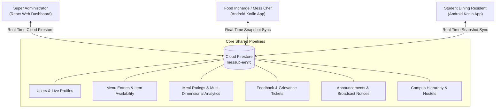
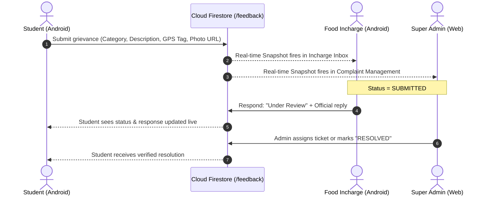

# MessUP Production Deployment & 3-User Synchronization Pipeline

> **Every Meal Matters.**  
> Authoritative guide to the connected architecture, deployment readiness, and live Cloud Firestore pipeline synchronization of the **MessUP** dining quality and operations system.

---

## 1. System Overview & The Three User Roles

MessUP unites three distinct user personas across mobile (**Android Native Jetpack Compose**) and web (**React 19 + TypeScript + Vite**) over a shared, authoritative **Google Cloud Firestore** real-time backend (`messup-ee9fc`):

| User Persona | Client Platform | Primary Scope & Access |
| :--- | :--- | :--- |
| **🎓 Student** | Android Native (Jetpack Compose) | View daily & weekly menus, inspect live dish availability, submit multi-dimensional meal ratings, report grievance issues with genuine device GPS tags & photos, read facility announcements, update personal profile. |
| **👨‍🍳 Food Incharge** | Android Native (Jetpack Compose) | Schedule and publish meals, toggle live dish stock availability, cancel/delay meal periods with notices, respond officially to student grievances, broadcast mess notices, inspect live quality scores. |
| **🛡️ Super Admin** | Web Dashboard (React + Vite + Tailwind) | Campus hierarchy (Institutions, Hostels, Mess Facilities), staff provisioning, student verification, centralized menu overrides, cross-campus ratings analytics, grievance moderation, audit logs. |

---

## 2. The 5 Core Synchronization Pipelines

### Pipeline 1: User Provisioning, Authentication & Live Profiles
- **Firestore Paths:** `/users/{uid}` and `/users/{email}`
- **Student Flow:**
  - Student registers from the Android app selecting their assigned Hostel and Dining Hall.
  - Account is initialized with `role: "STUDENT"` and `isApproved: true`, mapped directly to their campus dining facility.
- **Food Incharge Flow:**
  - Super Administrator provisions Food Incharges via the Web Dashboard (`InchargeManagement.tsx`).
  - Record is stored with `role: "FOOD_INCHARGE"`, linked to their authorized dining hall (`messId`) and updated in `/messes/{messId}`.
  - Incharge logs in via the Android login screen role toggle ("👨‍🍳 Food Incharge").
- **Real-Time Sync:**
  - Any administrative update (e.g. reassigning an incharge or approving a student) triggers the real-time `addSnapshotListener` on the mobile device, refreshing local DataStore session and UI without requiring re-login.

### Pipeline 2: Daily Menus & Real-Time Dish Availability
- **Firestore Path:** `/menuEntries/{messId}_{date}_{mealType}`
- **Storage Convention:** Canonical document ID format: e.g. `MESS_001_2026-11-07_BREAKFAST`.
- **Incharge Control:**
  - Food Incharge can toggle out-of-stock items (e.g. "Available" vs "Stock Out") or publish custom dishes for any of the 4 daily slots (*Breakfast, Lunch, Evening Snacks, Dinner*).
- **Student View:**
  - The Student Home Screen and Weekly Menu Screen filter dynamically by the student's assigned mess facility (`userProfile.messId`).
  - Dish availability updates reflect instantaneously with real-time badges ("Available" / "Unavailable").
  - If a meal has not yet been published by the incharge, the UI displays `"No menu published yet for this meal."` instead of fake dummy dishes.

### Pipeline 3: Meal Ratings & Real-Time Analytics
- **Firestore Path:** `/mealRatings/{studentId}_{messId}_{date}_{mealType}`
- **Student Submission:**
  - After dining, students rate 5 key dimensions: *Taste, Food Quality, Hygiene & Cleanliness, Portion Size, and Overall Experience* (1 to 5 stars), along with qualitative feedback tags and comments.
- **Incharge Dashboard:**
  - The Food Incharge Android home screen dynamically computes real-time scorecards filtered to their mess hall, surfacing live ratings counts and dimension averages. If 0 reviews exist, clean indicators (`—` or `0.0`) are presented without fake fallback scores.
- **Admin Dashboard:**
  - Recharts analytics on the web dashboard aggregates campus-wide dining scores, rating distributions, and student sentiment tags.

### Pipeline 4: Grievance & Feedback Resolution Lifecycle
- **Firestore Path:** `/feedback/{complaintId}` (e.g. `COMP_AB12CD`)

### Pipeline 5: Announcements & Campus Notices
- **Firestore Path:** `/announcements/{announcementId}`
- **Publishing:**
  - Food Incharges publish notices scoped to their specific mess facility.
  - Super Administrators broadcast global or mess-specific notices.
- **Student Display:**
  - Filtered so students receive notices relevant to their assigned mess facility plus campus-wide broadcasts.

---

## 3. Complete Removal of Hardcoded Proxy / Dummy Data

All mock, seed, and proxy fixtures have been removed across both codebases:

### Web Admin Dashboard (`admin-dashboard/src/`)
1. **Eliminated `DEFAULT_CAMPUS_SEED`**: Removed the 400+ line static seed fixture in `backend.ts` containing hardcoded students (`STUDENT_SUSIL_621`, `STUDENT_PRIYA_789`, `STUDENT_RAHUL_332`), dummy incharge (`INCHARGE_DEMO_01`), pre-cooked menus, and fake reviews.
2. **Clean State Management**: Functions `getLocalOrSeed`, `mergeEntities`, `mergeMenus`, `mergeRatings`, and `mergeAndDeduplicateUsers` now operate strictly on authentic Firestore documents, defaulting to clean empty arrays `[]`.
3. **One-Time Storage Migration**: Added automatic one-time cleanup (`messup_seed_purged_v2`) to wipe legacy mock entities cached in `localStorage`.
4. **Auth Hardening**:
   - Removed `loginAsDemoAdmin`, `messup_admin_demo`, and backdoor password `Admin@2030` from `AuthContext.tsx`.
   - Cleared prefilled credentials (`theweber0000@gmail.com` and `Admin@2030`) from `LoginScreen.tsx`.
   - Admin sign-in now strictly authenticates against Firebase Auth and checks Firestore `/users` role.
5. **Neutral UI Placeholders**: Updated placeholders in `RatingsAnalytics.tsx`, `InchargeManagement.tsx`, and `StudentManagement.tsx` to generic labels (`"Search student name..."`, `"e.g. Food Incharge Name"`).
6. **Dynamic Campus Entity Fallbacks**: Replaced hardcoded `'INST_CUTM_001'` and `'Centurion University...'` fallbacks in user editing with dynamic assignments.

### Android Application (`app/src/main/`)
1. **MenuRepository**: Removed 70 lines of hardcoded fake dishes (Dosa, Uttapam, Jeera Rice, etc.) in `getDefaultMenuForMeal`. When no meal has been scheduled, it returns an empty entry with `dishes = emptyList()` and `isPublished = false`.
2. **Student & Incharge Profiles**: Removed hardcoded email checks for `susilmoharana621`, fake phone `+91 9439001234`, and hardcoded campus names in `StudentProfileScreen.kt` and `InchargeProfileScreen.kt`. Real user attributes or `"Not Assigned"` are rendered.
3. **Rating Metrics**: Removed hardcoded fallback scores (`4.4 ★`, `4.3 / 5.0`, `4.7 / 5.0`, `4.4 / 5.0`) from `StudentHomeScreen.kt` and `InchargeHomeScreen.kt`. Displays `"0.0"` or `"—"` when no reviews have been submitted.
4. **Student Feedback GPS Tagging**: Replaced hardcoded coordinates (`20.2961, 85.8245`) with genuine device `LocationManager` GPS coordinates or the dining facility location tag.
5. **Student Registration**: Removed pre-selected `"Ganga Boys Hostel"` and hardcoded CUTM text from `AuthScreens.kt`.
